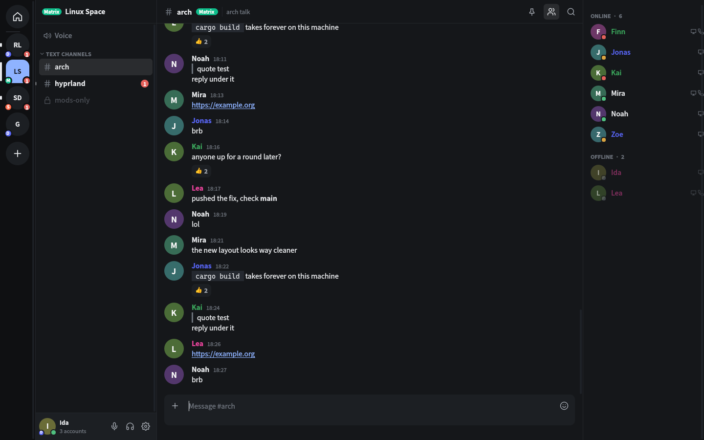
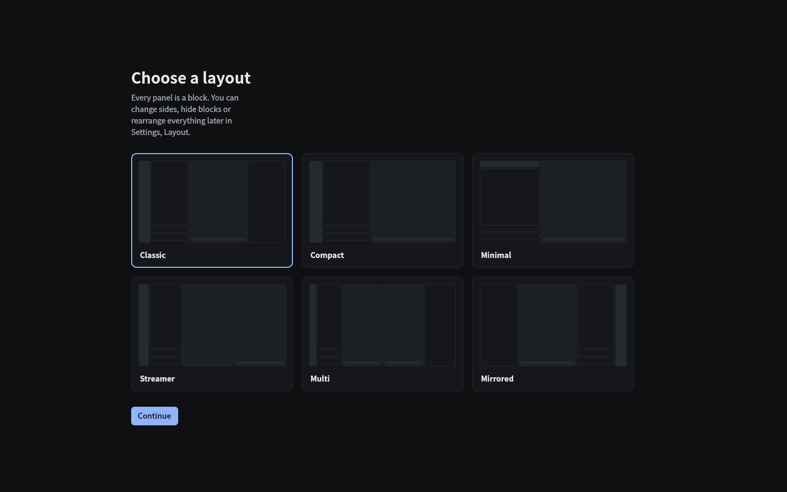

# cord

A native, moddable chat client for **Discord**, **Matrix** and **Stoat** in one app.

Servers, spaces, DMs and friends from all three networks share a single server bar and a single friends list. Every object carries a small network badge, everything else behaves the same.

## Status

Early development. Nothing here is usable yet.

## Goals

- Full Discord feature parity: text, threads, forums, reactions, embeds, stickers, voice, video, screen share with audio, stages, soundboard, events, server management
- Matrix (via `matrix-rust-sdk`, with E2EE) and Stoat on the same footing
- Built-in client mods that usually need Vencord: message logger, hidden channels, silent typing, emoji and sticker passthrough, stream quality unlock, Spotify controls, translation and more, each toggleable
- Block based UI: every panel is a block. Pick a preset on first launch, flip simple toggles, or rearrange everything in edit mode. Layouts are plain files and can be shared
- Themes with hot reload, design tokens and full QML component overrides
- Mod API in QML/JS and WASM, the built-in features use the same API

## Stack

Rust core, Qt 6 / QML UI through [cxx-qt](https://github.com/KDAB/cxx-qt). Voice through PipeWire and Opus, Discord E2EE through libdave, Matrix and Stoat calls through LiveKit, screen capture through the XDG desktop portal with hardware encoding.

## Screenshots





## Install

From source into `~/.local`, or any other prefix via `PREFIX=`:

```sh
./install.sh
./install.sh --uninstall
```

The script builds a release binary, installs `bin/cord`, `share/cord/qml`, the desktop entry and the icon, and prints the Arch package names of any missing dependency.

On Arch Linux:

```sh
cd packaging/arch
makepkg -si
```

Runtime dependencies: Qt 6 (base, declarative, multimedia), GStreamer with base, good and bad plugins, `gst-plugin-pipewire`, PipeWire, libsecret, opus. Optional: `playerctl`, `wl-clipboard` or `xclip`.

## Building

Requires Rust, Qt 6.8+ (base, declarative, multimedia), PipeWire, libsecret.

```sh
cargo run -p cord
```

## Configuration

Everything lives in `~/.config/cord`:

- `ui.json`: layout and UI settings
- `cfg.json`: application settings
- `themes/*.json`: themes
- `mods/<name>/main.qml`: mods
- `blocks/<id>.qml`: overrides for built-in blocks

## Mods

A mod is a directory with a `main.qml` under `mods/`.

```qml
import QtQuick
import Cord

Item {
    Component.onCompleted: {
        S.hook("send", o => o)
        S.regBlk("clock", Qt.resolvedUrl("Clock.qml"), "Clock")
    }
}
```

## Theme format

A theme is a JSON object with the keys `bg`, `bg2`, `bg3`, `bg4`, `hov`, `sel`, `ln`, `tx`, `tx2`, `tx3`, `ac`, `acTx`, `ok`, `warn`, `err`, `ment`, `r`, `rs`, `font`, `mono`, `fs` and `dens`. Colors are `#RRGGBB`, or `#RRGGBBAA` when 8 digits are used.

## Keyboard shortcuts

- Ctrl+K: quick switcher
- Ctrl+,: settings
- Ctrl+E: edit layout
- Alt+Up / Alt+Down: previous / next channel
- Shift+Esc: mark read
- Up: edit last message
- Middle click: open in second chat

## Disclaimer

Using third party clients on Discord is against Discord's Terms of Service and may get your account suspended. Use at your own risk. Matrix and Stoat explicitly allow third party clients.

## License

GPL-3.0-or-later
